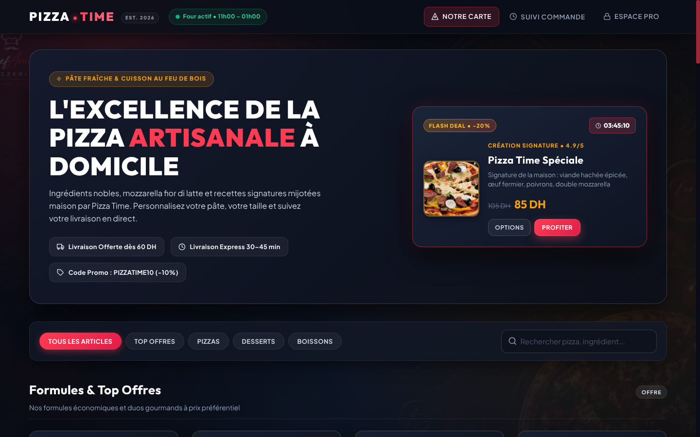

<div align="center">

```text
  ____  ___ _____ _____    _      _____ ___ __  __ _____ 
 |  _ \|_ _|__  /__  /   / \    |_   _|_ _|  \/  | ____|
 | |_) || |  / /   / /   / _ \     | |  | || |\/| |  _|  
 |  __/ | | / /_  / /_  / ___ \    | |  | || |  | | |___ 
 |_|   |___/____|/____|/_/   \_\   |_| |___|_|  |_|_____|
           EST. 2026 // WEB ORDERING & KITCHEN KDS
```

# PIZZA TIME — Web Ordering, Kitchen KDS & Admin Platform (v2.0)

A full-stack Flask pizzeria e-commerce platform, real-time Kitchen Display System (KDS), and Admin Analytics & Management Suite crafted with a dark-glass culinary UI.

<br/>



<br/>

---

</div>

## Key Features

### Customer Storefront
- **Minimalist Brand Header & Live Oven Status Pill**: Features a typographic wordmark (`PIZZA.TIME EST. 2026`), a live pulsing oven status indicator (`Four actif • 11h00 – 01h00`), and quick order tracking access.
- **Interactive Flash Deal Spotlight**: Hero showcase featuring a live countdown timer (`HH:MM:SS`), high-resolution photography, discount badge, and 1-click Add / Customize actions.
- **Interactive Pizza Customizer Modal**: Customize any pizza's **Size** (*Medium 28cm*, *Large 33cm +15 DH*, *XL Familiale 40cm +25 DH*), **Crust** (*Pâte Fine Artisanale*, *Pâte Pan Moelleuse*, *Bord Fourré Fromage +12 DH*), and **Extra Toppings** (*Double Mozzarella*, *Champignons Frais*, *Pepperoni Boeuf*, *Olives Noires & Origan*, *Sauce Piquante Maison*). Customizations persist end-to-end into the Kitchen KDS, Admin Order Manager, and printable customer receipts.
- **Promo Code & Coupon Engine**: Supports instant promo codes in both the slide-over Cart Drawer and Checkout (`PIZZATIME10` for `-10%`, `FIRSTORDER` for `-15 DH` on orders >= `70 DH`), validated server-side.
- **Quick Order Lookup & 1-Click Re-Order Modal**: Customers can look up their recent orders by phone number directly from the navbar (`Suivi Commande`), check live preparation status, or re-populate their cart in one click (`Re-commander`).
- **Interactive Menu & Instant Filtering**: Filter by category (*Top Offres*, *Pizzas*, *Desserts*, *Boissons*) or search in real-time by name and ingredients.
- **Slide-Over Cart Drawer**: Real-time quantity controls, toast notifications, promo code input, and an interactive **Free Delivery Progress Bar** (Free delivery unlocked at `60 DH`).
- **Streamlined Checkout**: Supports both **Home Delivery** (*Livraison à domicile*) and **In-Store Pickup** (*Retrait au restaurant*), with **Cash on Delivery** or **Card (TPE)** payment options.
- **Live 4-Step Order Tracker & Printable Receipt**: Customers can track their order status in real-time (*Reçue* -> *Confirmée* -> *Au Four* -> *Prête / Livrée*) with automatic polling and invoice printing.

### Staff Kitchen Control Center (KDS)
- **3-Column Kanban Workflow**:
  1. **A Confirmer (Appel)**: Verify new incoming orders by phone with one-click dialer.
  2. **Confirmees / En Attente**: Validated orders queued for the oven with itemized quantities.
  3. **En Cuisine (Au Four)**: Active preparation column with one-click completion.
- **Web Audio Chime & Auto-Refresh**: Automatically polls for new incoming orders and triggers a synthesized kitchen chime without requiring external audio files.

### Admin Suite
- **Analytics Dashboard**: 6 real-time KPI cards (*Chiffre d'Affaires*, *Commandes Aujourd'hui*, *En Cours*, *Panier Moyen*, *Articles Vendus*, *Clients*), 7-day Chart.js revenue trend, and Top 5 Best Sellers progress bars.
- **Order Management**: Search by client name, phone, or order `#ID`, filter by client history, view itemized order contents, update statuses, and print receipts.
- **Client Directory (CRM)**: Searchable customer database displaying total lifetime spend (`DH`), order count, phone dialer, and direct link to client order history.
- **Menu Manager**: Add, edit, toggle visibility (*Actif* / *Masqué*), upload photos, or safely archive/delete menu items.

---

## Quick Start (Automated Bash Installer)

Clone the repository and run the automated installation script `install.sh`:

```bash
git clone https://github.com/ZaneGoat/Pizzeria-wep.git
cd Pizzeria-wep
chmod +x install.sh
./install.sh --run
```

### Installer Options
```bash
./install.sh                # Install venv, dependencies, init DB, and seed menu + sample data
./install.sh --run          # Install everything and immediately launch the server on port 5000
./install.sh --no-samples   # Install and seed menu only (without sample orders)
./install.sh --port 8080    # Customize server port
```

---

## Manual Setup (Linux / macOS / Windows)

1. **Create and activate a virtual environment:**
   ```bash
   # Linux / macOS
   python3 -m venv venv
   source venv/bin/activate

   # Windows (PowerShell / CMD)
   python -m venv venv
   venv\Scripts\activate
   ```

2. **Install dependencies:**
   ```bash
   pip install -r requirements.txt
   ```

3. **Initialize the database and default accounts:**
   ```bash
   flask --app app init-db
   ```

4. **Seed menu items & optional sample data:**
   ```bash
   python seed_menu.py
   python seed_samples.py
   ```

5. **Run the application:**
   ```bash
   flask --app app --debug run
   ```
   Open **`http://127.0.0.1:5000/`** in your browser.

---

## Default Accounts

| Role | Username | Password | Access |
| :--- | :--- | :--- | :--- |
| **Administrator** | `admin` | `admin123` | Analytics, Orders, Clients, Menu CRUD, Kitchen KDS & Storefront |
| **Kitchen Staff** | `staff` | `staff123` | Kitchen Control Center (KDS) & Storefront |

---

## Tech Stack

- **Backend**: Python 3.10+, Flask, Flask-SQLAlchemy, Flask-Login, Werkzeug
- **Database**: SQLite (`instance/pizzeria.db`)
- **Frontend**: HTML5, CSS3 (Custom Glassmorphism Design System), Vanilla ES6 JavaScript, Chart.js
